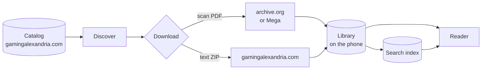

<div align="center">



<br>

[](https://github.com/Aymansal1/Gloss/actions/workflows/build.yml)
[](https://github.com/Aymansal1/Gloss/releases/latest)


**[Install](#install)** &nbsp;·&nbsp; **[Reading](#reading)** &nbsp;·&nbsp; **[Search](#search)** &nbsp;·&nbsp; **[How it works](#how-it-works)** &nbsp;·&nbsp; **[Building](#building)**

</div>

<br>

Gloss is an Android reader for [Gaming Alexandria](https://www.gamingalexandria.com)'s archive of scanned Japanese game magazines, such as Famitsu, Beep and LOGiN, with AI transcriptions and English translations. Browse the catalog, download an issue, and read the original page. When you tap any text on the scan, a strip of gold sweeps under it and its English opens right beside it.

The name works two ways. It means the glossy page, and it means a *gloss*, the note a translator writes in the margin. Gloss reads the same catalog and data files as Gaming Alexandria's desktop app, [Rosetta Magazine Researcher](https://github.com/duhubz/Rosetta-Magazine-Researcher), and is built for a phone held in one hand.

<br>

## Install

1. On your phone, open **[the latest release](https://github.com/Aymansal1/Gloss/releases/latest)** and tap `Gloss-<version>.apk`.
2. When Android asks, let your browser install apps.
3. That's it. Gloss checks GitHub for new versions and tells you when one is out. Each update installs over the top and keeps your library, bookmarks and your place in every issue.

Gloss needs Android 13 or newer. It has no accounts, no analytics and no ads.

<br>

## Reading

- **Tap any text on the scan** to gloss it. The box fills with gold leaf, and its English appears in a card beside it, with the Japanese underneath. Tap the card to read the whole page.
- **Pull up the sheet** to read the page as translation, original or summary, or to slide through page thumbnails.
- **Translate the whole page** with the 文/A button. It sets the English inside every text box on the scan, sized to fit.
- **Pinch or double-tap** to zoom. The page renders sharper as you zoom in, and the gloss card stays readable at any zoom.
- **Turn your phone sideways** to see facing pages side by side, the way the magazine was printed.
- **Pages turn right to left**, like the printed magazines. You can switch this under **Aa**.
- Bookmarks with notes, "Continue reading", adjustable text size, and light, dark or automatic appearance. The reader itself always stays dark.
- **Text-only downloads** skip the scan to save space. You can add the scan later.
- **Interrupted downloads pick up where they stopped**, including from Mega.
- **Back up your reading** (bookmarks, notes, your page in every issue) to a file, and restore it on another phone.

> [!IMPORTANT]
> The transcriptions and translations are machine-generated and can be wrong. Check anything that matters against the scan.

<br>

## Search

Search looks inside every issue on your phone, in English or Japanese. An ordinary word index treats a Japanese sentence as one long word, so a term in the middle of it never matches. Gloss indexes Japanese as overlapping character pairs and splits your query into the same pairs, so `マリオ` finds スーパー**マリオ**３.

| Query | Finds |
|---|---|
| `mario kart` | pages with both words |
| `"strategy guide"` | the exact phrase |
| `zelda -manual` | Zelda, but not pages that mention the manual |
| `strat*` | strategy, strategies, stratagem… |
| `攻略` | 攻略 anywhere in the Japanese |

<br>

## How it works



Each issue is two files. The **scan** is a PDF hosted on archive.org or Mega. The **data ZIP** holds Gaming Alexandria's transcription, translation and page summaries (`_COMPLETE.txt`), where each block of text sits on each page (`_COORDINATES.json`), and the issue's details (`metadata.txt`).

Gloss pairs paragraph *n* of the original with paragraph *n* of the translation. It then fuzzy-matches each original paragraph to a box on the scan, and that link is what lets you tap to gloss and translate a whole page.

Gloss downloads Mega files without Mega's app. It asks Mega's public API for the file, decrypts it on the phone, and checks Mega's integrity code before it keeps the file. If a download is cut off, Gloss rebuilds that check from the part already saved and carries on from the last whole chunk.

<details>
<summary><b>Project layout</b></summary>

<br>

| Path | What's there |
|---|---|
| `app/src/main/java/app/gloss/data/` | Catalog, Rosetta text and coordinate parsers, the on-device library, reading state and backups |
| `…/download/` | Background downloads with WorkManager, resumable `.part` files, and the Mega decryptor |
| `…/search/` | The SQLite FTS4 index and Japanese character-pair search |
| `…/pdf/` | Page rendering with Android's `PdfRenderer` |
| `…/update/` | The GitHub Releases update check |
| `…/ui/theme/` | Colours, type (Inter and Instrument Serif) and motion springs |
| `…/ui/components/` | The shared kit: glass bars, large titles, the tab bar, cells, switches, covers |
| `…/ui/` | Screens: Discover, Series, Issue, Library, Search, Settings and the Reader |
| `app/src/test/` | Unit tests for the parsers, search, spreads, backups, update checks and Mega decryption |
| `docs/brand/` | `build.py` draws the icon, wordmark and this banner from the bundled fonts |

</details>

<br>

## Building

GitHub Actions runs the unit tests and builds the APK on every push. Pushes to `main` are published as a release (see [`.github/workflows/build.yml`](.github/workflows/build.yml)).

To build locally you need JDK 17 and the Android SDK:

```sh
./gradlew :app:testDebugUnitTest   # unit tests
./gradlew :app:assembleDebug       # app/build/outputs/apk/debug/app-debug.apk
```

Release builds are signed with a key that is not in this repo. CI reads it from four repository secrets: `GLOSS_KEYSTORE_BASE64`, `GLOSS_KEYSTORE_PASSWORD`, `GLOSS_KEY_ALIAS` and `GLOSS_KEY_PASSWORD`. Without them, for example on a fork, the release build is signed with the debug key and nothing is published.

To redraw the icon, wordmark and banner after changing them, run `python3 docs/brand/build.py` from the repo root (it needs `fonttools`).

<br>

## Credits

The catalog, scans, transcriptions and translations come from [Gaming Alexandria](https://www.gamingalexandria.com), whose desktop [Rosetta Magazine Researcher](https://github.com/duhubz/Rosetta-Magazine-Researcher) defines the data format Gloss reads. Gloss is an independent project and is not affiliated with Gaming Alexandria.

Gloss uses [Inter](https://rsms.me/inter/) and [Instrument Serif](https://github.com/Instrument/instrument-serif), both under the SIL Open Font License (see [`licenses/`](licenses/)), and [Haze](https://github.com/chrisbanes/haze) for the frosted glass.

## License

[AGPL-3.0](LICENSE).
